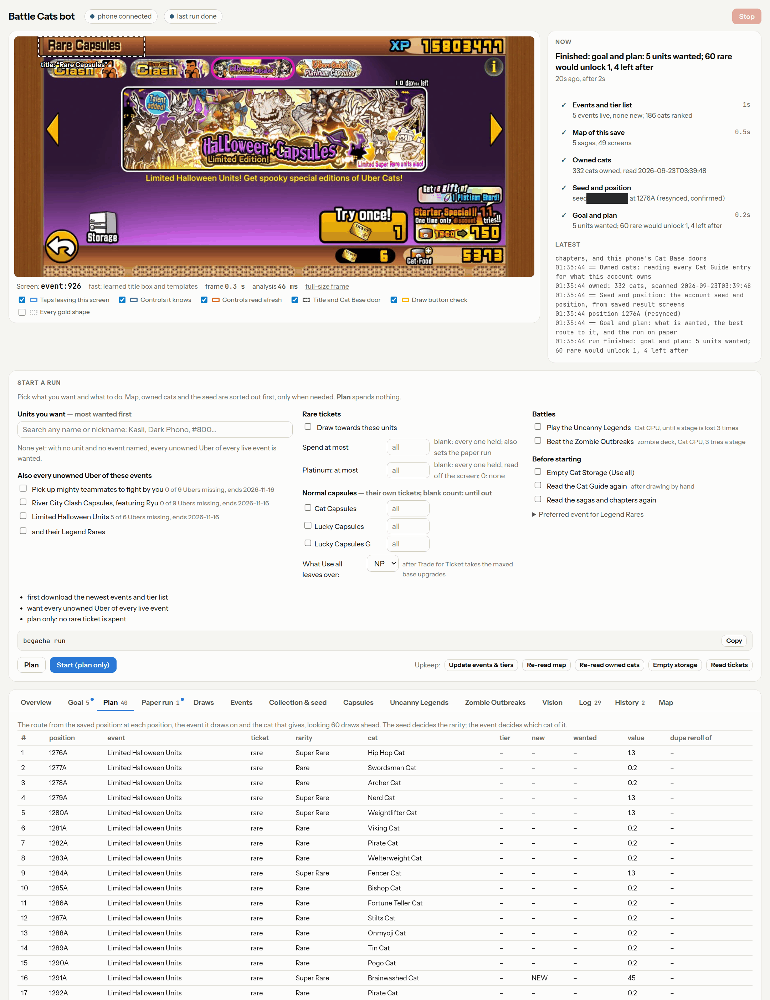

# battle-cats-automation


[](https://github.com/NotEoin/battle-cats-automation/actions/workflows/ci.yml)

> *Every Rare Cat Capsule, known before you open it.*

bcgacha (the command this repo installs) draws Battle Cats capsules for you
on an iPhone or iPad plugged into your computer. It knows in advance what
every draw will give, works out which banner to draw on at each step to reach
the cats you want, and taps the phone's screen to do it.



> **This breaks the game's rules.** PONOS's terms of service forbid "external
> tools which falsely manipulate the Service such as BOT and/or cheat tools".
> bcgacha is one. Using it can get your account banned. You use it at your own
> risk.

## What it is for

[The Battle Cats](https://battlecats.club/en/series/battlecats/) is a mobile
strategy game by PONOS. You build a lineup of cats and send them across the
battlefield to knock down the enemy base. Most of the strongest cats come from
the Rare Cat Capsule, a gacha draw paid for with Rare Cat Tickets or Cat Food.
On a standard banner, 5 draws in 100 give an Uber Rare, and each event banner
offers its own Ubers for a limited time.

Which draws give an Uber is fixed by the account's seed; the banner you draw
on only decides which Uber you get. Drawing blind wastes those draws on cats
you already own, or on a banner whose Ubers you did not want. bcgacha picks
the banner for every draw so that each Uber draw lands on a cat you want, then
makes the draws itself, so a stack of tickets needs no tapping by hand.

## Highlights

- **Plans before it spends.** `bcgacha plan` shows every draw on the way to
  the cats you want, and what each one gives. It needs no phone after the
  first run.
- **Drives the real game.** It taps an unmodified phone over USB through
  Apple's own developer features: no jailbreak, no modified app, no
  developer account.
- **Checks every step.** It reads each result off the screen and compares
  it with the prediction. When they differ, it works out from the cat it saw
  where the account really is.
- **More than draws.** It also opens Cat Capsules and Lucky Capsules, clears
  Cat Storage, and plays the Uncanny Legends and the Zombie Outbreaks with
  the Cat CPU.
- **A page you can watch.** While it runs, a page in your browser shows what
  it sees, what it plans, and a Stop button. You can start runs from there
  too.
- **Made for people who have never used a terminal.** One install command,
  and `bcgacha check` says what is wrong with the phone's setup and how to
  fix it.

## How it works

The Rare Cat Capsule is not random to someone who knows the account's seed.
One number drives every rare draw, it is shared by every banner, and only a
rare draw moves it on. bcgacha reproduces the game's draw tables from
godfat's [battle-cats-rolls](https://gitlab.com/godfat/battle-cats-rolls)
dataset, so from the seed it can compute what any sequence of draws gives,
and choose the banner at each step that brings you closer to your goal.

On the phone side, it learns where each button is by reading the screen the
first time it runs on a device, so it ships no pictures of the game. The
[developer guide](docs/developer-guide.md) covers the details.

## Tech stack

Python 3.11 or later, with no compiled code of its own.

| Part | Built with |
|---|---|
| Talking to the phone | [pymobiledevice3](https://github.com/doronz88/pymobiledevice3): a userspace tunnel to the device (no root, no Xcode), the DVT instruments channel for screenshots, and CoreDevice's HID touch service for taps at any point on the screen |
| Draw prediction | a 32-bit xorshift generator and the game's draw tables, rebuilt from godfat's dataset (YAML, read with PyYAML) and tested against pages saved from bc.godfat.org |
| Reading the screen | OpenCV template matching and colour masks for buttons and shapes; RapidOCR on ONNX Runtime for titles, names and numbers |
| Matching names | rapidfuzz, so `kasli` or a typo still finds Dark Kasli |
| Tier list | httpx, Beautiful Soup and lxml, to read the community tier list |
| Live page | Python's own `http.server` and one plain HTML page, with no web framework or build step |
| Install and CI | uv, setuptools, ruff and pytest; GitHub Actions on Windows, macOS and Linux |

## What you need

- An iPhone or iPad running **iOS 27 or later** (iPadOS 27 on an iPad), with
  The Battle Cats (English version) installed. Tapping the screen from a
  computer needs iOS 27; older versions can be watched but not driven.
  Updating also brings Apple's age checks in some countries; read
  [the note before you update](docs/howto/prepare-your-device.md#before-you-update-to-ios-27).
- A computer running Windows 10 or 11, macOS, or Linux.
- A USB cable that carries data, not just charge.

No Apple developer account, jailbreak or paid software is needed.

## Install

Follow the guide for your computer.

- [Install on Windows](docs/howto/install-on-windows.md)
- [Install on macOS](docs/howto/install-on-macos.md)
- [Install on Linux](docs/howto/install-on-linux.md)

Then get the phone ready: [Prepare your iPhone or iPad](docs/howto/prepare-your-device.md).

In short, every guide comes down to installing `uv` and then this one command:

```
uv tool install https://github.com/NotEoin/battle-cats-automation/archive/refs/heads/main.zip
```

## First run

Plug the phone in, unlock it, open The Battle Cats, and in a terminal type:

```
bcgacha check     # checks the cable, the phone and its settings, and says how to fix each
bcgacha           # asks what you want, step by step, and does it
```

The first run on a phone takes longer. bcgacha reads the game's menus to
learn where the buttons are on your screen, and reads the Cat Guide to learn
which cats you own. After that it remembers.

bcgacha also needs your account's seed once. If you have used bc.godfat.org
before, you may know it already; if not, finding it costs about ten Rare Cat
Tickets. See [Find your seed](docs/howto/find-your-seed.md).

While anything runs on the phone, the live page is at
<http://127.0.0.1:8765> in your browser.

## Everyday use

| You want to | Type |
|---|---|
| see what bcgacha knows | `bcgacha status` |
| find a unit by name | `bcgacha search kasli` |
| see the plan without spending anything | `bcgacha plan -t "Dark Kasli"` |
| draw for units, most wanted first | `bcgacha run -t "Dark Kasli" -t Gunduros --roll` |
| want every Uber of an event | `bcgacha run -e "Iron Legion" --roll` |
| open Cat Capsules or Lucky Capsules | `bcgacha run --capsules cat` |
| play the Uncanny Legends | `bcgacha run --play-legends` |
| beat the Zombie Outbreaks | `bcgacha run --play-outbreaks` |
| do it all from the browser instead | `bcgacha ui` |
| stop | press Ctrl+C, or Stop on the page |

bcgacha asks before it spends anything, unless you add `-y`. The
[user guide](docs/user-guide.md) explains every option and what a run does.

## Devices

| Device | Status |
|---|---|
| iPhone 16e (2532 x 1170 screen) | tested |
| other iPhones with a 2532 x 1170 screen (12, 13, 14 and their Pro models) | same screen shape, expected to work |
| other iPhones | expected to work, not yet tested |
| iPad | expected to work for drawing, not yet tested; the battle players are least likely to |

bcgacha finds most buttons by reading the screen, so it adapts to each device
on the first run. A few positions, mostly in the battle players, were measured
on one phone. On a device with a screen shape nobody has tested yet, bcgacha
says so before it starts. If you try one, please
[report how it went](docs/howto/report-a-new-device.md), whether it worked or not.

## Help

- [Troubleshooting](docs/troubleshooting.md): what an error means and how to fix it
- [All documentation](docs/README.md)
- [Open an issue](https://github.com/NotEoin/battle-cats-automation/issues) if you are stuck

## For developers

```
git clone https://github.com/NotEoin/battle-cats-automation
cd battle-cats-automation
uv venv && uv pip install -e ".[test]"
uv run pytest            # needs no phone and no network
uv run ruff check .
```

The [developer guide](docs/developer-guide.md) explains how it works, and
[CONTRIBUTING.md](CONTRIBUTING.md) how to send a change.

## Credits and licence

The cat pools and the event schedule come from godfat's
[battle-cats-rolls](https://gitlab.com/godfat/battle-cats-rolls) dataset,
downloaded when bcgacha runs. Tier rankings come from the community list at
[battlecatstierlist.com](https://www.battlecatstierlist.com). Talking to the
phone is done by [pymobiledevice3](https://github.com/doronz88/pymobiledevice3).

bcgacha is released under the [MIT License](LICENSE). It is not affiliated
with PONOS or Apple; see [NOTICE](NOTICE).
